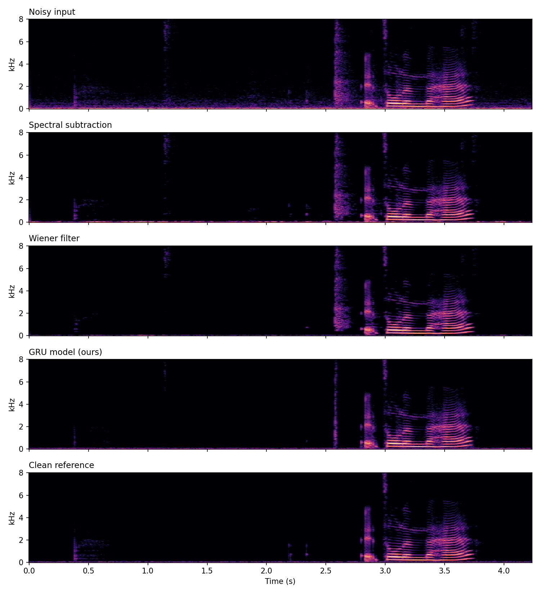
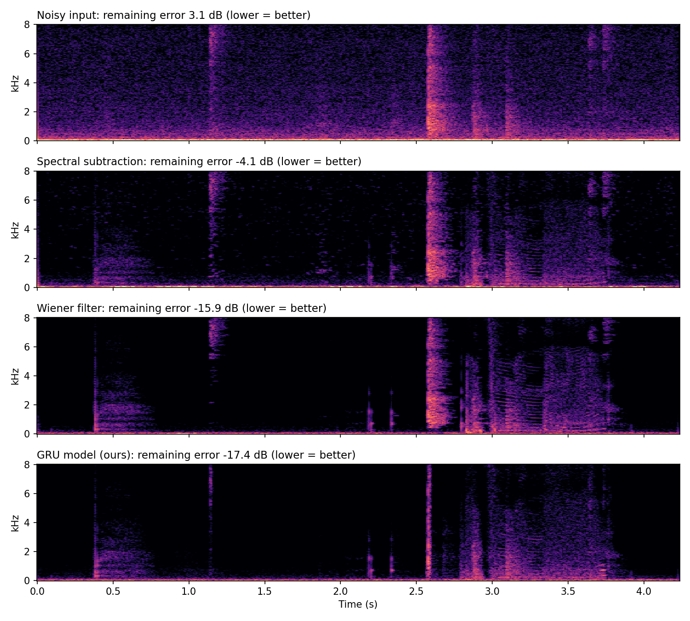
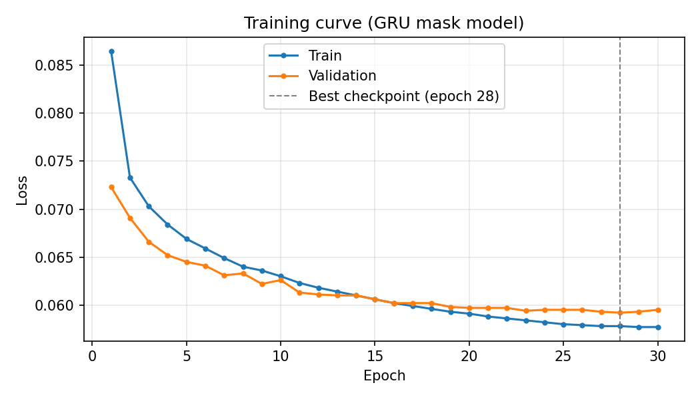

# Real-time speech denoising: classic DSP vs. a small causal neural network

I compare two classic speech-enhancement methods (**spectral subtraction** and a **Wiener filter**) with a small **causal GRU mask model** (0.92 M parameters) on the standard **VoiceBank-DEMAND** benchmark. All methods are scored on the 824-file test set (unseen speakers and unseen noise types) with **PESQ**, **STOI** and **SI-SDR**.

**Key result:** the GRU model beats both DSP baselines on all three metrics. It is also the only one of the three that improves intelligibility, and the only one that suppresses non-stationary noise, while running about 190× faster than real time on a GPU.

## Results

VoiceBank-DEMAND test set: 824 files, 16 kHz, mean over all files.

| Method | PESQ (wb) ↑ | STOI ↑ | SI-SDR (dB) ↑ |
|---|---|---|---|
| Noisy input | 1.97 | 0.921 | 8.45 |
| Spectral subtraction | 2.27 | 0.921 | 13.01 |
| Wiener filter (decision-directed) | 2.35 | 0.910 | 15.76 |
| **GRU mask model (causal, 0.92 M params)** | **2.67** | **0.938** | **17.63** |

- **Real-time factor:** 0.0053 on a T4 GPU, so 1 s of audio is processed in about 5 ms.
- **Sanity check:** the noisy-input PESQ (1.97) matches the value commonly reported for this dataset, which confirms that the data and evaluation pipeline are set up correctly.

### Hardest test clip

This is clip `p257_199`, where the noise is louder than the speech (input SI-SDR −3.1 dB).

| Method | PESQ | STOI | SI-SDR (dB) |
|---|---|---|---|
| Noisy input | 1.11 | 0.56 | −3.11 |
| Spectral subtraction | 1.28 | 0.55 | 4.01 |
| Wiener filter | 1.99 | 0.54 | 15.80 |
| **GRU model** | **2.33** | **0.60** | **17.36** |



The next figure shows the remaining error (output minus clean reference) for each method. Darker means a better result.



## Findings

1. **DSP methods only handle stationary noise.** Both baselines remove the steady low-frequency noise but leave a sudden noise burst at about 2.6 s almost untouched. They estimate the noise spectrum once, from the leading frames, and assume it doesn't change. The GRU model learned what speech looks like and suppresses that burst too.
2. **The Wiener filter reduces intelligibility.** On the full test set, Wiener improves PESQ and SI-SDR but lowers STOI below the noisy input (0.910 vs 0.921). The error spectrogram shows why: during speech (2.8–3.8 s) it removes or distorts parts of the speech itself, especially low-energy and high-frequency components. The GRU model is the only method that improves STOI (0.921 → 0.938).
3. **Limitation: the GRU model over-suppresses quiet speech at very low SNR.** On the hardest clip, low-energy speech segments (0.4–0.7 s, plus short sounds at 2.2 and 2.35 s) are attenuated. STOI on that clip is only 0.60, because a small magnitude mask with the noisy phase cannot recover speech that is buried this deeply.
4. **Where this stands.** State-of-the-art models on this benchmark reach considerably higher PESQ, but they are much larger and often non-causal. This model is deliberately small, causal and real-time capable.

## Method

| Component | Details |
|---|---|
| Data | VoiceBank-DEMAND, 28-speaker training set (11,572 pairs), 824 test pairs, resampled from 48 kHz to 16 kHz; random 2 s crops for training; 5 % of the training files held out for validation |
| Spectral subtraction | Power subtraction (over-subtraction α = 2, spectral floor β = 0.02); noise estimated from the first 20 frames |
| Wiener filter | Decision-directed a-priori SNR estimate (Ephraim & Malah, 1984), gain floor 0.05 |
| GRU model | STFT (512-point, hop 128) → log-magnitude (257 bins) → Linear + LayerNorm + PReLU (256) → 2-layer unidirectional GRU (256) → sigmoid mask (257 bins) → iSTFT with the noisy phase |
| Loss | L1 on power-law compressed magnitudes (exponent 0.3) + 0.1 × waveform L1 |
| Training | AdamW, lr 1e-3, cosine schedule, batch 32, 30 epochs, gradient clipping 5.0, about 9 min on a T4 GPU |
| Metrics | PESQ (wide-band), STOI, SI-SDR |

**Numerical stability.** The first training run produced NaN losses. Zero-padded or silent frames made the magnitude gradient |X| undefined at X = 0 (0/0). I fixed this with a stable magnitude, √(Re² + Im² + ε).

### Training curve



The loss converges after about 20 epochs. Train and validation loss stay close together, so there is no sign of overfitting. The best checkpoint is from epoch 28 (validation loss 0.0592).

## Next steps

- Predict a complex mask or estimate phase, instead of reusing the noisy phase
- Look into perceptual or metric-based losses to reduce over-suppression of quiet speech
- Report results per noise type and SNR level
- Measure CPU latency and try quantization for on-device use

## Reproduce

```bash
pip install -r requirements.txt
python train.py --noisy DATA/noisy_trainset_28spk_wav --clean DATA/clean_trainset_28spk_wav --epochs 30 --out checkpoints
python evaluate.py --noisy DATA/noisy_testset_wav --clean DATA/clean_testset_wav --ckpt checkpoints/best.pt --out results
```

I trained and evaluated on Google Colab (free T4 GPU).

## Dataset

C. Valentini-Botinhao et al., *Noisy speech database for training speech enhancement algorithms and TTS models*, University of Edinburgh, DataShare: https://datashare.ed.ac.uk/handle/10283/2791

## Author

**Manoli Bhadeshiya**, M.Sc. Neural Engineering (HTW Saar)
